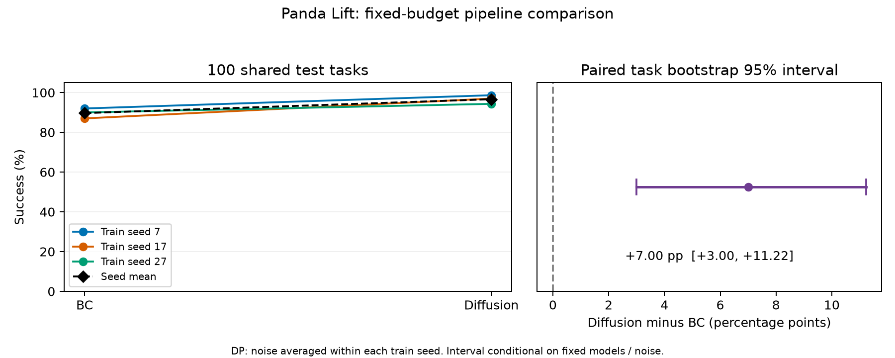

# Panda Lift：BC 与动作扩散的固定预算对照

本目录是2026-10-20完成的三维仿真阶段归档。使用MuJoCo / robosuite Panda Lift、robomimic策略与官方低维演示；不是Franka真机部署。仓库根目录的二维项目是较早阶段，两者数据和结果不能混用。

| 方法 | seed7 / 17 / 27 | 平均成功率 | 参数量 | 三模型训练合计 |
|---|---|---|---|---|
| BC，两层1024 MLP | 92% / 87% / 90% | 89.67% | 1.08M | 1.5分钟 |
| 动作扩散，U-Net + EMA + DDIM10 | 98.67% / 97% / 94.33% | 96.67% | 65.76M | 27.3分钟 |

同180条训练演示、batch32、每模型10000更新，另20条valid演示隔离。20个验证仿真任务选模后冻结六个模型，在100个共同物理初始任务上最终评测一次。BC300、扩散900次回放仍只有100个独立任务。固定模型条件下，扩散−BC为+7.00个百分点，配对任务95%重采样区间[+3.00,+11.22]。未以扩散必须胜出作为验收条件。



## 先读哪里

- [完整结果与限制](RESULTS.md)：成功率、噪声、成本、计时及验收范围。
- [后续学习记录](docs/LEARNING-HANDOFF.md)：用户希望真正理解的学习顺序、实践验收与求职故事；暂未开始教学。
- [面试讲解提纲](docs/INTERVIEW-NOTES.md)：事实、时序与追问。
- [固定实验协议](configs/STUDY-PLAN.md)与[环境准备和复现](docs/REPRODUCING.md)。
- [源码身份](evidence/provenance.json)、[汇总](evidence/summary.json)、[本机记录审计报告](evidence/audit.json)。

## 视频

视频重放来自保存的实际策略轨迹，没有额外执行策略；[视频索引](evidence/video-index.json)绑定原记录。原相对路径videos/在公开归档中对应media/。

| 方法 | 成功 | 失败 |
|---|---|---|
| BC | [播放](media/bc-success.mp4) | [播放](media/bc-failure.mp4) |
| 扩散 | [播放](media/diffusion_policy-success.mp4) | [播放](media/diffusion_policy-failure.mp4) |

## 复现入口与边界

准备Python3.11、GPU/EGL、固定依赖与数据后，在本目录执行：

```bash
.venv/bin/python -m pytest -q tests
./sim preflight --out runs/NEW-PREFLIGHT
./sim study --preflight runs/NEW-PREFLIGHT --out runs/NEW-STUDY
./sim audit --out runs/NEW-STUDY
```

预检与正式实验拒绝覆盖历史目录；训练失败或超时保留未完成状态，不自动换配置续跑。正式预算由预检确定，10k不满足8小时则统一6k，仍不满足就停止。`./sim status`是旧冒烟入口，正式状态查看新run的status.json。

公开归档不包含数据、模型、虚拟环境、完整轨迹或系统日志；不能只靠已发布audit.json重新审计缺失的原始记录。没有声称其他机器已复现。19维观察包含物体真值，7维动作是OSC_POSE而非关节力矩。官方成功只要求物块中心超过桌面4cm，不等于稳定抓取或真机可靠性。

扩散重新规划均值约56ms，超过20Hz单周期50ms；分块摊销不能证明实时无停顿。真实型号与接口后续确认。本轮已收尾，不自动新增训练；后续先个人学习验收，再分析失败与规划图像输入。
